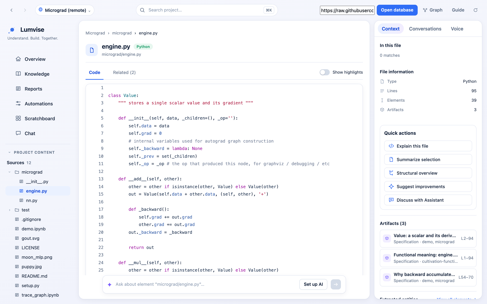
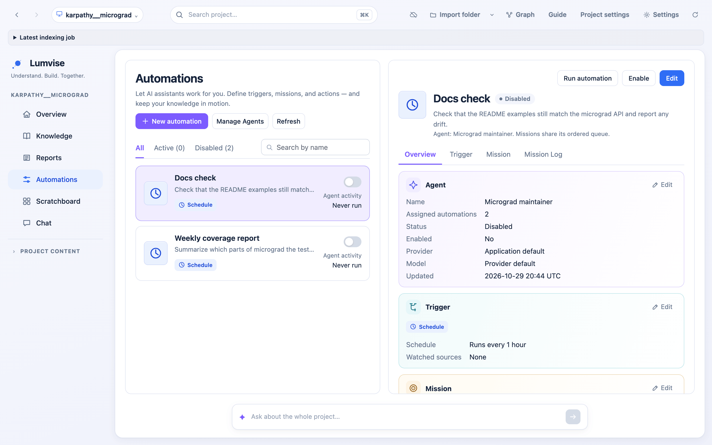
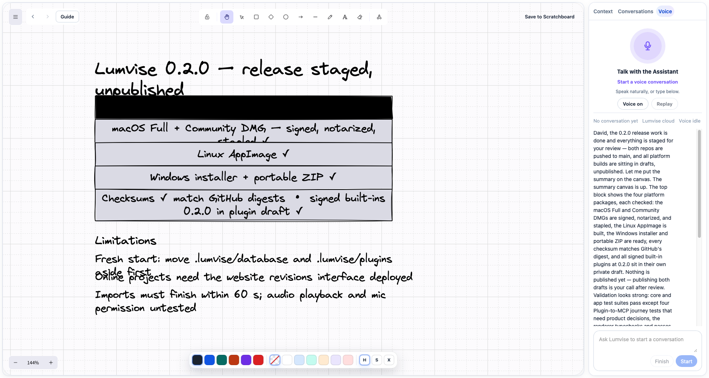
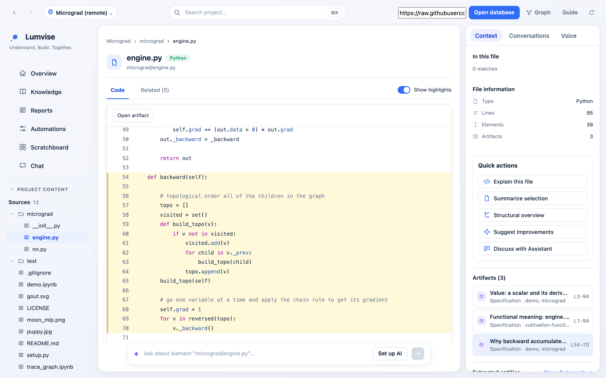
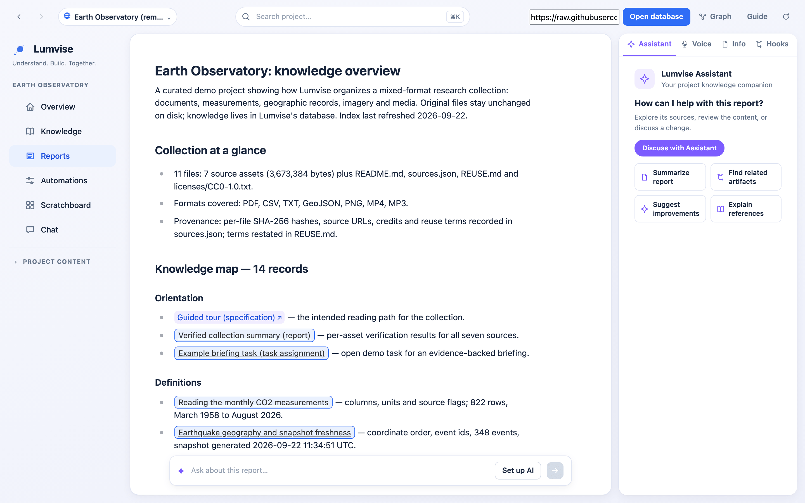
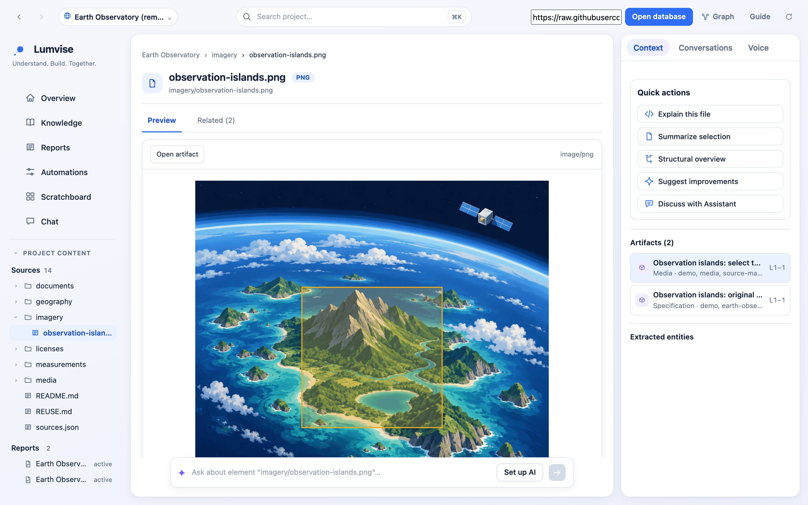

# Lumvise

**Your project's knowledge, in one place, for you and your agents.**

Lumvise keeps source files, documents, media, saved knowledge and conversations
in one workspace on your computer. People and connected AI agents read and write
the same project memory through MCP, background agents keep reports up to date,
and you can talk the project through with an Assistant that draws on a
whiteboard.

## Download Lumvise 0.2.0

| Platform | Edition | Package |
| --- | --- | --- |
| macOS 14 or later, Apple Silicon | Full and Community | DMG |
| Linux x64 | Full | AppImage |
| Windows 10 or later, x64 | Full | Installer or portable ZIP |

[**Download Lumvise 0.2.0**](https://github.com/Lumvise/lumvise-main/releases/latest)
from the latest release. Each download has a SHA-256 checksum file and ships
with signed plugins. Windows builds are not code-signed, so Windows shows a
warning for unknown software; see the [platform notes](#platform-notes). Not sure which edition you need? See
[Choose an edition](#choose-an-edition).

Lumvise 0.2.0 starts with a fresh database and does not open data from earlier
versions. Follow the steps under "Before you update" in the
[0.2.0 release notes](https://github.com/Lumvise/lumvise-main/releases/tag/v0.2.0)
before you start it.

**New in 0.2.0**

- Reusable background agents and Automations that run on schedules or watches
  (Full).
- Documents that cite code, Knowledge records and other documents.
- Notes on image regions and on audio and video time segments.
- History and retention for Knowledge records and project content.
- A redesigned Workspace: Overview, Knowledge, Reports, Automations, Scratchboard
  and Chat.
- An Assistant that queues requests instead of refusing them while it is busy.

[Watch the demo](#an-assistant-you-can-talk-to) ·
[Explore a graph online](https://lumvise.com/workspace?repo=https%3A%2F%2Fraw.githubusercontent.com%2FLumvise%2Flumvise-main%2Fmain%2Fdemos%2Fhuggingface__safetensors%2F.lv%2Fgraph.pz) ·
[Choose an edition](#choose-an-edition) ·
[Contributing](#contributing)



*The Workspace on the micrograd demo: destinations on the left, `engine.py` in
the middle, and the Knowledge attached to it with quick actions on the right.
Actual Lumvise app views; the Automations screenshot comes from the desktop
Full edition, and Community provides the local Knowledge and Semantic
capabilities through MCP. [Media credits](assets/readme/credits.txt).*

## Your knowledge in one place

A project is more than its code. Lumvise brings source files, documents, images,
audio and video, saved Knowledge and your conversations into one Workspace, so
you do not have to search several tools for the reasoning behind a file.

Browse a folder, open a file or a PDF, preview media, and see the Knowledge
attached to each. Save an explanation, a decision, a specification or a report
where it belongs, and find it again next to the source it describes.

The [Earth Observatory demo](demos/earth-observatory/) shows this beyond code: a
research collection with a PDF, CSV measurements, geographic records, imagery,
audio and video. Its guide explains the example annotations and each source's
provenance.

## Shared project memory for people and agents

Lumvise keeps project memory local first. The database lives on your computer,
and any MCP-capable editor or AI client can connect to it to inspect project
structure and create or retrieve Knowledge. What you or one agent saved is
there for the next person or agent, with no copy-and-paste between tools. See
[Connect an MCP client](#connect-an-mcp-client).

A project can also travel as a portable `.pz` snapshot, like the demo graphs in
this repository. Others open it in the online graph viewer and explore it in a
browser without installing Lumvise.

[Explore the Safetensors demo online](https://lumvise.com/workspace?repo=https%3A%2F%2Fraw.githubusercontent.com%2FLumvise%2Flumvise-main%2Fmain%2Fdemos%2Fhuggingface__safetensors%2F.lv%2Fgraph.pz)
without installing the desktop app.

## Automatic reports with Automations

*Full edition.* Background agents work on the project while you do something
else. An agent is a shared worker with its own model, permissions, documents and
queue. An Automation decides when and what: each has its own name, schedule,
watches, task and actions. Run one weekly at a set time in your time zone or when
something it watches changes, and let it keep a generated report or document up
to date. Several Automations can share one agent, or each can use its own.

An Automation can send a message to a recipient you choose, another agent or the
project's Assistant inbox. The agent writes the content but cannot pick a
different recipient. Messages in the Assistant inbox do not start a
conversation or speak.



*The Automations screen: each Automation shows its schedule, its agent and its
state. These two belong to a demo agent and are disabled.*

## An Assistant you can talk to

*Full edition.* Ask the Assistant by voice or by text. It answers aloud beside
an interactive whiteboard, so you can follow a technical explanation with a
diagram you can inspect, annotate and discuss. Turn voice off to continue in
text. Save a whiteboard you want to keep, archive a conversation when you are
done, and reopen it later.

If the Assistant is busy, your request is queued and started when it is free.
Agents ask you questions through the same queue.



*The desktop Assistant dashboard: an editable whiteboard beside the conversation
and voice controls. This release-planning example was captured before 0.2.0 was
published. The capture excludes the debug status bar above the dashboard.*

[Media credits](assets/readme/credits.txt)

Things to ask:

- **Understand a new repository:** “Find the module that owns this behavior and
  explain how its main pieces connect.”
- **Make architecture visible:** “Sketch this request flow on the whiteboard and
  walk me through each step.”
- **Keep a decision:** “Save why we chose this design, with the tradeoffs, and
  attach it to the module it affects.”
- **Review research:** “Summarize this document and separate the evidence from
  what we still need to check.”

## Project context attached to the code

Knowledge is pinned to the exact place it describes: a function, a line range,
an image region, or a segment of an audio or video file. The semantic graph shows
how files, functions and other elements relate, so you can move from a
folder to an element, follow its relationships, and read the Knowledge attached
to it. Documents can cite code and Knowledge records, so a report links back to
its evidence.



*A Knowledge record pinned to `backward()` in `micrograd/engine.py` (lines 54–70):
it stays attached to the function after the conversation ends, and another MCP
session can retrieve it.*

[](https://lumvise.com/workspace?repo=https%3A%2F%2Fraw.githubusercontent.com%2FLumvise%2Flumvise-main%2Fmain%2Fdemos%2Fearth-observatory%2F.lv%2Fgraph.pz)

*A report document whose Knowledge map links every record it cites.
[Explore the research demo online](https://lumvise.com/workspace?repo=https%3A%2F%2Fraw.githubusercontent.com%2FLumvise%2Flumvise-main%2Fmain%2Fdemos%2Fearth-observatory%2F.lv%2Fgraph.pz).*



*A media note on an image region: the outlined mountain belongs to the selected
note. Notes can also pin to an audio or video time segment.*

Knowledge uses three kinds: `requirements`, `specification` and `media`.
Reports and context are documents. Knowledge records and project content keep
their revisions, and a project's retention setting decides how much history is
kept.

## Try a graph online

[Inspect the Safetensors demo graph in your browser](https://lumvise.com/workspace?repo=https%3A%2F%2Fraw.githubusercontent.com%2FLumvise%2Flumvise-main%2Fmain%2Fdemos%2Fhuggingface__safetensors%2F.lv%2Fgraph.pz)
with the online graph viewer. The link points to the sample graph hosted in this
repository, so you can explore it without installing the desktop app.

## Choose an edition

Both editions share the local database, Knowledge and Semantic plugins, and MCP
access. Full adds the graphical workspace, Automations and the desktop
Assistant.

| Edition | How you use it | What is included | Source license |
| --- | --- | --- | --- |
| **Community** | Through an MCP-capable editor or AI client | Headless runtime, local database, MCP access, Knowledge and Semantic plugins | MIT core; LGPL-3.0-only public plugins |
| **Full** | Through the desktop app or an MCP client | Community capabilities, plus the graphical workspace, Automations, whiteboard, voice and text Assistant, and seven built-in plugins (Agents, Assistant, Canvas, Challenges, Knowledge, Nucleus, Semantic) | Proprietary desktop application; included open-source components retain their licenses |

Use Community when your MCP client is your interface. Use Full when you also
want to explore and discuss the same project knowledge visually. Community has
no desktop window; Full also supports MCP access.

This repository contains the Community source. The full application's
proprietary source and internal implementation documentation stay private.

### Platform notes

Packages are listed on the
[latest release](https://github.com/Lumvise/lumvise-main/releases/latest).

- **macOS:** Apple Silicon Macs running macOS 14 or newer. Full and Community
  DMGs are Developer ID signed and Apple-notarized, with notarization tickets
  stapled to the apps and DMGs.
- **Linux:** the Full AppImage is built against an Ubuntu 22.04 baseline. Make it
  executable, then run it. AppImages need FUSE; without it, start the file with
  `--appimage-extract-and-run`. Inference runs on the CPU. The tray icon needs a
  desktop panel with a status tray. The floating orb needs X11 or XWayland;
  Wayland sessions are untested.
- **Windows:** Windows 10 or later on x64. Use the installer or the portable ZIP.
  The installer and the program are not code-signed; choose **More info**, then
  **Run anyway** when Windows warns about unknown software. The installer adds
  the Microsoft WebView2 runtime if it is missing; the portable ZIP needs it
  installed already. Inference runs on the CPU.

## Build from source

Install the current stable Rust toolchain, a C/C++ toolchain, CMake and
Protobuf's `protoc`.
The bundled macOS installer script targets Apple Silicon and macOS 14 or newer.

```sh
git clone https://github.com/Lumvise/lumvise-main.git
cd lumvise-main
cargo build --locked --release -p lumvise-mcp-app-adapter --bin lumvise
```

The bare runtime has an empty plugin catalog. Install the Community plugin
bundle to enable Knowledge and Semantic tools; the packaged Community installer
includes that bundle. See [building and installing plugins](#plugins).

Saved sign-ins persist only on macOS, where they are stored in the login
Keychain. Linux and Windows builds have no persistent credential store yet:
sign-ins work for the running session and are lost when Lumvise quits.

### Terminal commands

Running `lumvise` without arguments in a terminal shows brief help for your
edition. Use `lumvise start` to launch the Full desktop app or the Community
headless runtime, and `lumvise --help` to show help explicitly. Opening the app
from Finder still starts it normally.

For an installed macOS edition, use its executable path:

```sh
"/Applications/Lumvise.app/Contents/MacOS/lumvise" start
"/Applications/Lumvise Community.app/Contents/MacOS/lumvise" --help
```

## Connect an MCP client

Set your client's MCP server command to the absolute path of `lumvise`, with the
`mcp` role and your project's absolute path. For clients using `mcpServers`:

```json
{
  "mcpServers": {
    "lumvise": {
      "command": "/absolute/path/to/lumvise",
      "args": ["mcp", "--project-root", "/absolute/path/to/your-project"]
    }
  }
}
```

The MCP process starts the local runtime when needed. Client configuration
formats vary; preserve the command and arguments when adapting this example.

Once the project is imported and indexed, try:

> Find the module that owns authentication. Save a specification explaining why
> tokens expire after one hour, attach it to that module, and read it back.

Knowledge and Semantic tools return the real artifact and element identifiers.
Use those identifiers when assigning knowledge, rather than guessing paths or
IDs. Reconnect after restarting the runtime to retrieve the saved record.

## Development

```sh
cargo fmt --all -- --check
cargo check --workspace --locked
RUST_TEST_THREADS=1 cargo test --workspace --locked
```

For a locally signed macOS installer and the official signing workflow, see
[macOS builds](#macos-builds). Development builds use your own plugin signing
key; company signing credentials are not required to build Community from source.

Bug reports, focused fixes, new language support and plugin contributions are
welcome. Read [contribution guide](#contributing) for the workflow and licensing
requirements. Please include a reproducible example with bug reports.

## Licensing

First-party Community core, SDK, protocol and tooling are licensed under
[MIT](LICENSE). The public Knowledge and Semantic plugin directories are licensed
under [LGPL-3.0-only](LICENSES/LGPL-3.0-only.txt), together with the incorporated
[GPL-3.0 terms](LICENSES/GPL-3.0-only.txt). Per-directory notices take precedence.
Both open-source licenses permit commercial use under their respective terms.

Third-party code, fonts, models and other assets retain their original licenses
and attribution. Release bundles include third-party notices and corresponding
source references. The proprietary full application has separate terms; its
restrictions do not limit rights in the included open-source components.

## Plugins

Community includes two plugins. Full bundles seven built-ins: Agents, Assistant,
Canvas, Challenges, Knowledge, Nucleus and Semantic. All built-in plugins are
version 0.2.0 and use plugin protocol 7.

| Plugin | Purpose | License |
| --- | --- | --- |
| Knowledge | Create, retrieve and assign typed project knowledge | LGPL-3.0-only |
| Semantic | Index and explore code elements and relationships | LGPL-3.0-only |

Connected agents that update the semantic index call `observe_index_base` first
and pass its result to `ingest_index_batch`; the tool descriptions explain this.

Plugins run as separate executables. The MIT-licensed SDK owns the Protobuf
handshake, framing, host calls and shutdown. Packages contain a signed manifest,
executables for declared targets, and any declared runtime assets.

<details>
<summary>Build, install, and develop plugins</summary>

### Build a Community bundle

On Apple Silicon macOS, use a protected Ed25519 signing key containing 32 raw
bytes or 64 hexadecimal characters, with file permissions `600`. Keep the key
outside the repository. A development key is independent of official release
credentials.

```sh
cargo run --release --locked -p lumvise-builtin-plugin-release -- \
  --composition minimal /absolute/private/development.key \
  /absolute/output/community-plugins aarch64-apple-darwin
```

`minimal` is the package format's name for the Community composition. The output
contains `builtins-release.json`, the Knowledge and Semantic `.lvp` archives,
`publisher-trust.json`, and `host-capability-grants.json`. Preserve the directory
as a unit. The signing key is not part of the output.

### Install and run

For a fresh, isolated installation, point the runtime at the bundle and separate
state directories:

```sh
export LUMVISE_BUILTIN_RELEASE_DIR=/absolute/output/community-plugins
export LUMVISE_PLUGIN_ROOT=/absolute/development-state/plugins
export LUMVISE_RUNTIME_ROOT=/absolute/development-state/runtime
export LUMVISE_DB_PATH=/absolute/development-state/database
export LUMVISE_STATE_ROOT=/absolute/development-state/state
./target/release/lumvise
```

Use the same environment when launching the MCP client command. Existing
publisher trust and capability-grant policies are preserved. Installing a new
publisher requires deliberately adding its verified public key and grants;
an incoming bundle cannot replace your policy.

For an existing installation whose publisher is already trusted, stop the
runtime, install the release, then restart:

```sh
cargo run --locked -p lumvise-plugin-admin -- \
  install-release /absolute/output/community-plugins
```

Updates must use a higher semantic version. Restarting with an older bundled
plugin preserves the selected newer version. A version identifies immutable
signed content: rebuilds with changed content need a new version.

### Create a plugin

Implement `PluginApplication` from `lumvise-plugin-sdk`, declare the exported
capabilities and required host capabilities in the manifest, and call the SDK's
`run_stdio` entrypoint. The SDK's crate documentation contains a minimal example.
Use host capabilities for application services instead of opening the host's
database or reconstructing its storage backends.

Package a compiled payload with:

```sh
cargo run --locked -p lumvise-plugin-package --bin lumvise-plugin-packager -- \
  /absolute/plugin/manifest.json /absolute/plugin/payload \
  /absolute/private/development.key /absolute/output/example.lvp
```

Match the manifest's protocol range to the SDK version, and include each
executable at its declared target path. Add tests through your plugin's public
capabilities. Do not log credentials or place signing material in packages.

### Knowledge assignments through MCP

Search with `app_plugin.builtin.semantic.search_graph`, using `project_root`
and a name or path filter. Copy a returned `semantic_element_id`. Pass that ID,
the project root, an artifact ID, title, content and a supported knowledge type
(`requirements`, `specification` or `media`) to `app_plugin.builtin.knowledge.create_knowledge`. Retrieve it using
`get_knowledge`, or inspect the element's assignments using
`list_knowledge_for_element`.

Read the mounted tool schemas for the exact arguments. Element and artifact
identifiers are returned by the tools; do not invent an element ID from a path.

### Rebuilding the LGPL plugins

The Knowledge and Semantic source, build descriptors and package manifests are
in this repository. You can modify and rebuild them with the commands above and
your own signing key. Use an isolated state directory or explicitly configure
your installation to trust that key. The host does not require the company
signing key for user-built plugins.

When redistributing these plugins, retain their license notices and satisfy the
LGPL's applicable source and modification requirements. The SDK and runtime
remain MIT; each third-party component retains its own license.

</details>

## macOS builds

Lumvise Community is the headless edition. It installs the local Lumvise MCP
server and the Knowledge and Semantic built-in plugins. It does not open a
desktop window. `scripts/build-macos-installer` builds the Community installer
from this repository; the Linux and Windows downloads are Full builds.

<details>
<summary>Build, sign, and install a macOS package</summary>

### Requirements

- An Apple Silicon Mac running macOS 14 or later.
- Xcode Command Line Tools and the Rust, CMake, and Protocol Buffers tools
  required by the project.
- The Rust target `aarch64-apple-darwin` (`rustup target add aarch64-apple-darwin`).
- A protected plugin release key accepted by the build script. Keep the key
  outside the checkout and set its permissions to `600`.

### Build a local installer

From the repository root, run:

```sh
chmod 600 "$HOME/.config/lumvise/plugin-release.key"
./scripts/build-macos-installer \
  "$HOME/.config/lumvise/plugin-release.key" \
  --edition community \
  --ad-hoc \
  --output-dir "$PWD/dist/community"
```

The Community edition is the default. `--ad-hoc` is for local testing: it skips
Apple notarization and does not produce an official signed release. For an official build, omit `--ad-hoc`, provide a complete reviewed
`--third-party-notices` inventory, and configure `APPLE_SIGNING_IDENTITY`
with a valid Developer ID Application identity and `APPLE_NOTARY_PROFILE`
with the notarization keychain profile.

Collect the dependency notices before packaging an official release:

```sh
python3 scripts/collect-third-party-notices \
  --cargo-manifest Cargo.toml \
  --license-overrides distribution/third-party-overrides \
  --output target/community-notices
```

Use a new output directory for each scan. The collector reports missing license
texts as errors and includes corresponding source for copyleft dependencies.
Review its inventory, then pass `--third-party-notices target/community-notices`
to the installer command. Private application sources are not required.

For packages distributed as native binaries, a reviewed license override can
include `source_archive` with `file` (a relative `.tar.gz` path), `sha256`, and
an HTTPS `source_url`. The collector verifies and copies that upstream source
archive, preserving its provenance, instead of archiving the installed binary.

With your Developer ID Application certificate and private key in Keychain, and
notarization credentials stored as `lumvise-notary`, build a signed installer:

```sh
export APPLE_SIGNING_IDENTITY='Developer ID Application: Your Company (TEAMID)'
export APPLE_NOTARY_PROFILE='lumvise-notary'
./scripts/build-macos-installer "$HOME/.config/lumvise/plugin-release.key" \
  --third-party-notices target/community-notices \
  --output-dir dist/community-signed
```

This signs the plugin executables before sealing their archives, signs and
notarizes the app and DMG, staples Apple's tickets, and checks Gatekeeper.
New signatures change plugin archive bytes: use a new plugin patch version for
a newly signed release. Reuse the same prepared signed archives when packaging
that release again; official builds reject ad-hoc plugin signatures.

### Resume an interrupted notarization

If a build fails after the app has been signed, the installer prints a retained
staging path. Keep that directory and repeat the same command with the same
edition, key, notices, output path, and other arguments, adding
`--resume-from '/path/printed/by/the/installer'`. Keep
`APPLE_SIGNING_IDENTITY` and `APPLE_NOTARY_PROFILE` set as for the original
command. For example, retry the Community command above as:

```sh
./scripts/build-macos-installer "$HOME/.config/lumvise/plugin-release.key" \
  --third-party-notices target/community-notices \
  --output-dir dist/community-signed \
  --resume-from '/path/printed/by/the/installer'
```

The staging directory retains the signed app, upload archives, DMG when
created, and notarization receipts. Receipts save Apple's submission ID and the
upload's SHA-256 before waiting; retries check the retained bytes and resume
that submission without uploading it again. The installer reuses the signed
plugin archives already in the app. To inspect a submission, use
`xcrun notarytool info ID --keychain-profile lumvise-notary` or retrieve its log
with `xcrun notarytool log ID --keychain-profile lumvise-notary`.

Resume applies only after a signed app exists. If the failure happened earlier,
diagnose it and make a fresh build. Resume also requires the original output
path, signing identity, and ad-hoc setting to match.

Rust build artifacts use the selected workspace's `target` directory by
default. To share a build cache across checkouts, add `--target-dir` followed by
the cache directory path. If you already have a signed Community plugin release
bundle, pass `--plugin-release` and its directory; the installer verifies it
with the release key before packaging it.

The output directory contains `Lumvise Community.app`, a versioned
`Lumvise-Community-<version>-macos-arm64-adhoc.dmg`, and its SHA-256 file.
Official builds omit the `-adhoc` suffix. Check the DMG checksum from that
directory with:

```sh
cd dist/community
shasum -a 256 -c Lumvise-Community-*.dmg.sha256
```

### Install and connect an MCP client

Open the DMG and drag `Lumvise Community.app` to Applications. The DMG includes
an `Install.txt` with the same connection details.

Add this server entry to the MCP client's JSON configuration, replacing the
project path with an absolute path:

```json
{
  "mcpServers": {
    "lumvise": {
      "command": "/Applications/Lumvise Community.app/Contents/MacOS/lumvise",
      "args": ["mcp", "--project-root", "/absolute/path/to/project"]
    }
  }
}
```

Restart the MCP client after saving its configuration. Lumvise runs as a
headless local service for that project.

</details>

## Contributing

Start with a small, focused change. For a substantial feature or public API
change, open an issue describing the user-visible behavior and proposed scope
before implementing it.

1. Fork this repository and create a branch.
2. Keep the change in the module that owns the behavior.
3. Add a regression test for a bug fix, or tests demonstrating new behavior.
4. Run formatting, checks and the relevant tests.
5. Open a pull request explaining the problem, the resulting behavior and what
   you verified. Include remaining limitations.

```sh
cargo fmt --all -- --check
cargo check --workspace --locked
RUST_TEST_THREADS=1 cargo test --workspace --locked
```

Use the existing plugin SDK and process protocol when adding a plugin. See
[plugin development](#plugins). Do not commit signing keys, credentials,
local databases, generated installers or machine-specific configuration.

Public core, SDK and tooling contributions use MIT. Contributions to the
Knowledge or Semantic plugins use LGPL-3.0-only. By submitting a contribution,
you agree to license it under the license applying to the files you change and
confirm that you have the right to do so. Preserve third-party notices, and
identify any third-party material you add.

This repository accepts changes to the Community edition. Keep confidential
material and proprietary application source out of issues and pull requests.
For sensitive security reports, use GitHub's private vulnerability reporting
when available instead of posting exploit details in a public issue.
